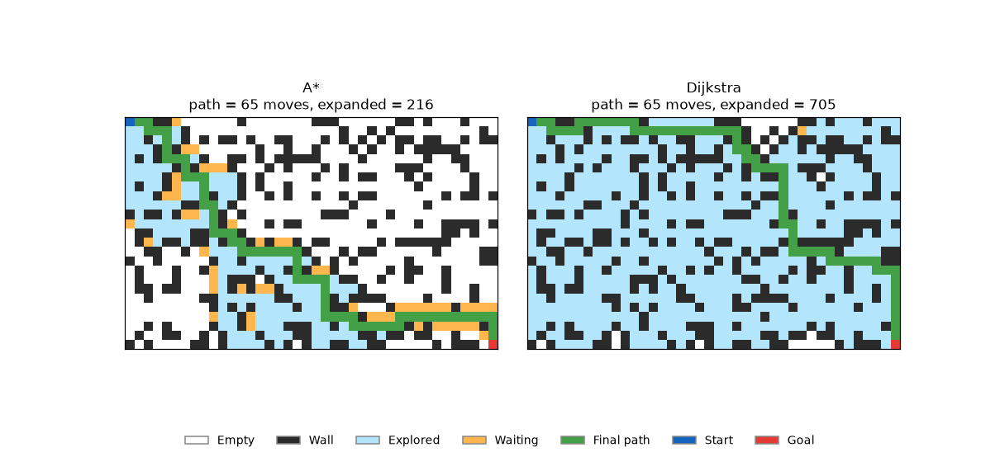
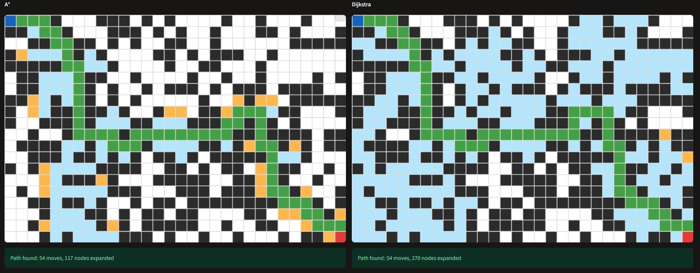

# Heuristic Graph Pathfinding Agent Search Engine

A lightweight Python application in which a virtual agent finds the shortest path through grid mazes using **A\* Search** and **Dijkstra's algorithm**, both implemented **from scratch** (only Python's built-in `heapq` is used for the priority queue).

You can draw or generate mazes, watch a search unfold step by step, compare the two algorithms on the same maze, and export the results as CSV and JSON.

It runs on the CPU only, needs no GPU, no deep-learning framework and no Docker, and works offline after installation.



*Same maze, same start, same goal. Both algorithms find the same 65-move path, but A\* expanded 216 nodes and Dijkstra expanded 705. Light blue = explored, orange = still waiting in the queue, green = final path.*



---

## Features

- **Two algorithms written from scratch:** A\* (Manhattan-distance heuristic) and Dijkstra, working on exactly the same grid and movement rules, so results are directly comparable.
- **Maze editor:** custom grid sizes (up to 100 x 100), click on the picture to draw or erase walls and to move the start and the goal.
- **Random mazes:** Easy / Medium / Hard / Custom obstacle density, a seed for reproducibility, and an option that guarantees a path exists.
- **Step-by-step visualization:** a step slider, Back / Next buttons, auto-play with speed control. Explored cells, waiting cells (the queue), walls, start, goal and the final path each have their own color.
- **Side-by-side comparison** of A\* and Dijkstra at the same step, with a results table, bar charts and a plain-English summary.
- **Performance dashboard:** execution time, path length, expanded nodes, explored-node density and path-found status.
- **Export:** CSV (metrics) and JSON (maze, path, metrics and the full step-by-step replay log) through download buttons, or from code.
- **Correct handling of edge cases:** unreachable goals, start or goal on a wall, positions outside the grid, start equal to goal.
- **188 automated tests**, including an independent BFS "referee" that checks the algorithms against the true shortest distance on hundreds of random mazes.

## Task requirements and where they are covered

| Requirement | Where |
|---|---|
| A\* and Dijkstra from scratch | `algorithms/astar.py`, `algorithms/dijkstra.py` |
| Varying grid obstacle arrays | `core/maze.py` (random mazes, densities, difficulty levels), the maze editor, and tests on small, medium and large grids at low and high density |
| Step count, runtime, expanded-node density | `core/metrics.py`, `core/pathfinding.py`, performance dashboard |
| Visualization of the search and path optimization | `visualization/visualizer.py`, the Streamlit app, GIF and PNG export |
| Exported logs | `core/exporter.py` (CSV and JSON) |
| Interactive UI | `app.py` (Streamlit) |

Q-Learning was an optional extension in the brief and is not implemented.

---

## Quick start (Windows)

You need **Python 3.10 or newer** (developed and tested with Python 3.13) and Git.

```powershell
git clone https://github.com/YOUR-USERNAME/heuristic-pathfinding-agent.git
cd heuristic-pathfinding-agent

python -m venv venv
venv\Scripts\activate

pip install -r requirements.txt

python -m streamlit run app.py
```

Your browser opens at `http://localhost:8501`. (If Streamlit asks for an email on the first run, just press Enter. Stop the app with `Ctrl + C` in the terminal.)

**Troubleshooting**

- *PowerShell refuses to activate the virtual environment:* run `Set-ExecutionPolicy -Scope CurrentUser RemoteSigned` once, or use Command Prompt (`venv\Scripts\activate.bat`).
- *`streamlit` is not recognized:* always start it with `python -m streamlit run app.py` while the virtual environment is active.

---

## Using the app

1. **Create a maze.** In the sidebar choose the number of rows and columns and a **Difficulty** (Easy = 10 % walls, Medium = 25 %, Hard = 40 %, or Custom). Press **Generate random maze**. Keep **Make sure a path exists** ticked if you want a solvable maze.
2. **Edit it.** Choose a tool (*Draw wall*, *Erase wall*, *Set start*, *Set goal*) and click on the maze picture. *Clear all walls* resets the walls.
3. **Run an algorithm.** Pick A\* or Dijkstra and press **Run selected algorithm**, or press **Compare both algorithms** to run both on the same maze.
4. **Watch the search.** Use the **Step** slider, **< Back / Next >**, or **Play** (with the speed slider). In a comparison both algorithms are shown at the same step, so you can see A\* finish early.
5. **Read the dashboard.** Metrics appear under the pictures: tiles for a single run, a table with charts and a summary for a comparison.
6. **Export.** Use **Download CSV** and **Download JSON** under *Export results*.

Editing the maze clears old results, so a picture is never shown for a maze it was not computed on.

### Using the code without the UI

```python
from core.maze import Maze
from core.pathfinding import compare_algorithms, format_table, run_search
from core.exporter import save_exports

maze, seed = Maze.random_solvable(20, 30, density=0.25, seed=2)

result = run_search(maze, "A*")                  # or "Dijkstra"
print(result.found, result.path_length, result.expanded_nodes)

results, rows = compare_algorithms(maze, repeats=5)   # same maze, both algorithms
print(format_table(rows))

save_exports(maze, results, folder="exports", name="my_run")   # writes my_run.csv and my_run.json
```

---

## How the algorithms work

The maze is a 2D grid: `0` = free cell, `1` = wall. The agent moves **up, down, left or right** (no diagonals), and every move costs **1**. Both algorithms use the same `Maze.neighbors()` method, so they follow identical movement rules.

Both keep three things:

- `g_cost`: the cheapest known cost from the start to each node found so far,
- `came_from`: each node's parent, used at the end to rebuild the path,
- a **priority queue** (`heapq`) of nodes waiting to be expanded.

They differ only in **how the queue is ordered**.

### Dijkstra

The queue is ordered by **cost so far** (`g`). Dijkstra knows nothing about where the goal is, so it spreads out in all directions like a ripple in water.

1. Put the start in the queue with cost 0.
2. Take the node with the lowest cost out of the queue. If it was already processed, skip it. Otherwise it counts as one **expanded node**.
3. If it is the goal, rebuild the path through `came_from` and stop.
4. For every walkable neighbor, compute `cost + 1`. If that is cheaper than what is known, record it and push the neighbor into the queue.
5. If the queue becomes empty, the goal cannot be reached.

### A\* Search

The queue is ordered by **f = g + h**, where `g` is the real cost so far and `h` is an estimate of the remaining distance. This project uses the **Manhattan distance**:

```
h(node) = |row - goal_row| + |col - goal_col|
```

The loop is the same as Dijkstra's. Ties in `f` are broken in favor of the smaller `h` (the node that looks closer to the goal), which reduces the number of expansions further.

### Why the paths are equal but the work is not

| | A\* | Dijkstra |
|---|---|---|
| Queue ordered by | `g + h` | `g` |
| Knows where the goal is | yes (through `h`) | no |
| Queue entry | `(f, h, node)` | `(cost, node)` |
| Finds the shortest path | yes | yes |

Dijkstra is exactly A\* with `h = 0` for every node.

- **A\* stays optimal** because the Manhattan distance never overestimates on a 4-direction grid: any route needs at least `|dr| + |dc|` moves. It is also *consistent*.
- **A\* never expands more nodes than Dijkstra here.** Every node A\* expands has `f` no larger than the optimal cost, so its `g` is below the optimal cost, and Dijkstra must expand every node with `g` below the optimal cost before it can finish. The test suite checks this on 125 random mazes.
- **When there is no path, the heuristic cannot help.** Both algorithms expand every reachable cell before giving up. A\* can even be slightly slower there, because computing `h` costs extra time per node.

---

## Performance metrics

Both algorithms use identical definitions.

| Metric | Definition |
|---|---|
| **Execution time** | `time.perf_counter()` around the search only (no drawing, no table building). The app reports the **median** of several repeats (default 3) to reduce noise. |
| **Path length** | Number of moves from start to goal (cells in the path minus 1). Empty if no path exists. |
| **Expanded nodes** | Nodes taken out of the priority queue and processed. Stale duplicate queue entries are skipped and **not** counted. The goal itself counts. |
| **Path found** | Whether the goal was reached. |
| **Explored node density** | `expanded nodes / total walkable cells x 100` |

Total walkable cells means every free cell of the grid, including cells that cannot be reached from the start (for example behind a wall).

---

## Example results

Measured on an Intel Core i7-3632QM, 8 GB RAM, Windows 10, Python 3.13 (median of 5 repeats). The node counts and path lengths are exact and reproducible. The times depend on the machine.

| Scenario | Algorithm | Path (moves) | Expanded nodes | Explored density | Time (ms) |
|---|---|---|---|---|---|
| 50 x 50, 25 % walls, seed 3 | `A*` | 100 | 365 | 19.40 % | 9.5 |
| | `Dijkstra` | 100 | 1874 | 99.63 % | 50.6 |
| 100 x 100, no walls | `A*` | 198 | 199 | 1.99 % | 8.2 |
| | `Dijkstra` | 198 | 10000 | 100.00 % | 229.1 |
| 20 x 20, full wall column (no path) | `A*` | none | 200 | 52.63 % | 4.0 |
| | `Dijkstra` | none | 200 | 52.63 % | 4.2 |

What this shows:

- **Same optimal path, very different work.** On the open 100 x 100 maze A\* expands about 2 % of the cells, while Dijkstra expands all of them.
- **Fewer nodes does not mean proportionally less time.** A\* does more work per node (it computes the heuristic and builds larger queue entries), so on the 50 x 50 maze it expands about 5x fewer nodes and is about 5x faster, while on the open 100 x 100 maze the gap is much larger.
- **With no path, there is no advantage.** Both explore the same 200 cells.

To reproduce the first row of the table:

```python
from core.maze import Maze
from core.pathfinding import compare_algorithms, format_table

maze = Maze.random(50, 50, density=0.25, seed=3)
print(format_table(compare_algorithms(maze, repeats=5)[1]))
```

---

## Exported data

### CSV (`pathfinding_results_<timestamp>.csv`)

One row per algorithm run:

```
algorithm,path_found,path_length,runtime_ms,expanded_nodes,total_walkable_cells,explored_density_percent,grid_rows,grid_cols,start_row,start_col,goal_row,goal_col,error
```

It opens directly in Excel or with `pandas.read_csv`.

### JSON (`pathfinding_results_<timestamp>.json`)

A complete record of the experiment (shortened example of the structure):

```json
{
  "format_version": 1,
  "exported_at": "2026-11-24T03:20:52",
  "notes": { "cells": "Positions are [row, col]. ...", "steps": "Replay log. ..." },
  "maze": {
    "rows": 25, "cols": 40,
    "start": [0, 0], "goal": [24, 39],
    "grid_legend": { "0": "empty", "1": "wall" },
    "grid": ["0001100000001000...", "..."]
  },
  "runs": [
    {
      "algorithm": "A*",
      "path_found": true,
      "path_length": 65,
      "expanded_nodes": 216,
      "path": [[0, 0], [0, 1], "..."],
      "steps": [ { "step": 1, "expanded": [0, 0], "pushed": [[1, 0], [0, 1]] } ]
    }
  ]
}
```

- Every position is `[row, col]`, and row 0 is the top row.
- The maze grid is stored as one text line of `0`/`1` characters per row, so you can read it by eye.
- `steps` is the **replay log**: for each expanded node, the neighbors it added to the waiting list. Replaying the steps in order reproduces the animation. It can be left out (checkbox in the app, `include_steps=False` in code) to make the file much smaller.

Exports can also be written straight to disk with `core.exporter.save_exports(...)`.

---

## Project structure

```
.
├── app.py                    Streamlit application (UI only)
├── requirements.txt
├── algorithms/
│   ├── astar.py              A* search from scratch
│   └── dijkstra.py           Dijkstra from scratch
├── core/
│   ├── maze.py               Grid, walls, start/goal, random and solvable mazes, difficulty presets
│   ├── result.py             SearchResult data class and path reconstruction (shared by both algorithms)
│   ├── pathfinding.py        run_search() and compare_algorithms(): one entry point, timing included
│   ├── metrics.py            Metrics, density formula, table labels, comparison summary
│   ├── editor.py             Click-to-cell conversion and editing tools (no Streamlit code)
│   └── exporter.py           CSV and JSON export
├── visualization/
│   └── visualizer.py         Cell colors, search replay frames, PNG figures, GIF animation
├── tests/                    188 automated tests
├── exports/                  Generated files (ignored by Git)
└── docs/images/              Screenshots used in this README
```

The dependency direction is one-way: `result.py` is used by the algorithms, the algorithms by `pathfinding.py`, and `pathfinding.py` by the UI. The UI contains almost no logic of its own; the rules live in `core/` where they are tested without a browser.

---

## Testing

```powershell
python -m pytest tests -q
```

The full suite takes one to two minutes on a modest laptop, because the app tests start Streamlit runs and the Play tests wait between animation frames. For a quick check while developing, skip the app tests:

```powershell
python -m pytest tests -q --ignore=tests/test_app.py
```

What is covered:

- **Both algorithms** are compared with an independent breadth-first search on hundreds of random mazes (sizes from 5 x 5 to 50 x 50, densities from 0 to 45 %). Path lengths must match the true shortest distance, paths must not cross walls, and every step must be a single 4-direction move.
- **Edge cases:** unreachable goals, goal walled in, start equal to goal, start or goal on a wall or outside the grid.
- **A\* versus Dijkstra** on the same mazes: same cost, A\* never expands more nodes, equal expansions when no path exists.
- **Metrics:** the density formula, consistent definitions, the comparison summary.
- **Visualization:** replayed frames match the search log, the path appears only at the end, GIF and PNG files are created.
- **Export:** CSV values match the results, JSON round-trips back into the same maze, and the replay log reproduces the explored cells.
- **The app itself** (using Streamlit's headless `AppTest`): sliders, buttons, editing rules, stale-result handling, playback, dashboard, export and failure paths.

---

## Design decisions

- **One result format for both algorithms** (`SearchResult`), and one entry point (`run_search`) that does the timing, so the comparison is fair by construction.
- **Expanded nodes** are counted when a node is popped from the queue and processed. Stale duplicates are skipped and not counted, in both algorithms.
- **Replay log instead of re-running:** the algorithms record `(expanded node, newly queued nodes)` for every step. The visualizer, the GIF and the JSON export all replay this one log, so the algorithms never needed to change when the visualization was added.
- **Independent checks:** the test referee (BFS) and `Maze.has_path()` (a flood fill) are deliberately not A\* or Dijkstra, so they can catch mistakes in them.
- **Lightweight UI:** the maze is drawn as one image from a NumPy array and a click is converted to a cell, so large grids stay responsive. Playback is limited to at most 120 pictures regardless of search length.
- **Results are tied to the maze they were computed on** (a fingerprint of the grid, start and goal), and are cleared as soon as the maze changes.
- **Grid size is capped at 100 x 100** (`MAX_SIZE` in `core/maze.py`) to keep the app responsive on modest hardware.

## Limitations and possible extensions

- Movement is 4-directional with unit cost. Diagonal moves or weighted cells would need a different heuristic (for example octile distance) and a cost per cell.
- Runtimes are measured in plain Python and include the cost of recording the replay log in both algorithms. They are good for comparing the two algorithms, not for absolute benchmarks.
- Random mazes are not guaranteed to be solvable unless **Make sure a path exists** is ticked. This is intentional, so unreachable goals can be tested.
- Not implemented: Q-Learning (optional in the brief), and bidirectional search or other heuristics.


<!-- Add a license section here if you want one, for example MIT. -->
